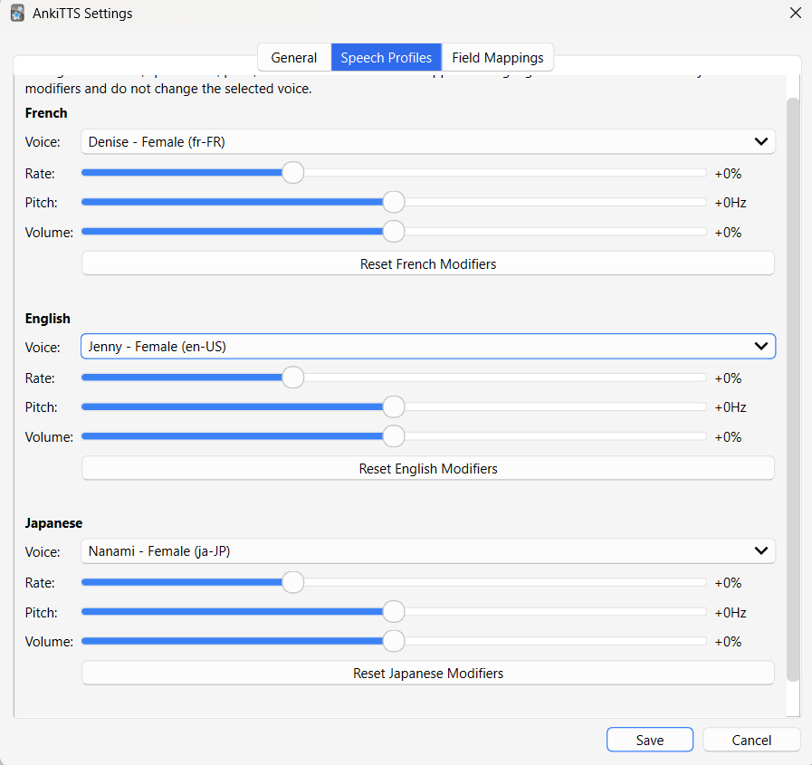
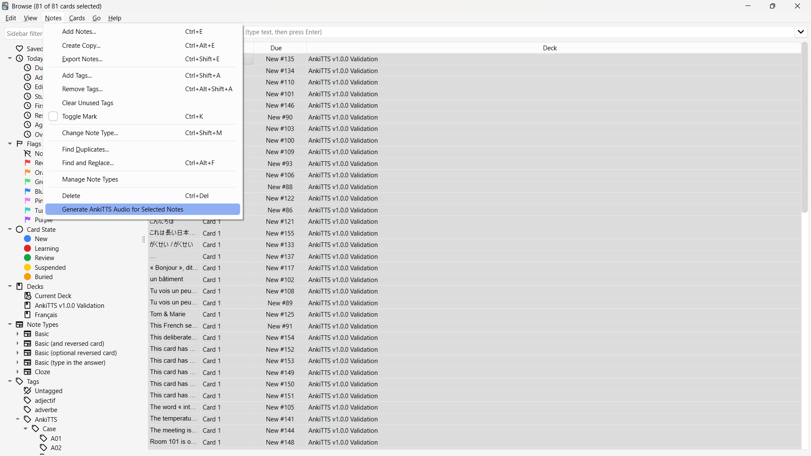

# AnkiTTS

**Generate natural multilingual speech automatically for your Anki cards: a local voice clone first, with cloud voices as fallbacks.**

AnkiTTS is an Anki add-on designed to make audio generation effortless. It supports automatic language detection, configurable speech profiles, browser batch generation, deterministic caching, and seamless integration into your Anki workflow. Speech comes from a chain of providers: Kyutai Pocket TTS running locally (cloned from your own reference recordings), Fish Audio, and Microsoft Edge Neural voices.

---

## Screenshots

### Settings



The Settings dialog provides configurable Speech Profiles, Field Mappings, providers, cache management, and language preferences.

### Browser Batch Generation



Generate audio for one note or hundreds of selected notes directly from the Anki Browser.

## Features

- 🎙 Automatic text-to-speech generation for Anki cards
- 🗣 Microsoft Edge Neural voices by default, free
- 🧬 Optional: local voice cloning with Kyutai Pocket TTS, and Fish Audio (both off by default)
- 🔁 Configurable provider fallback chain
- 🎭 RCE speech plans: a content voice and a label voice per language, proportional pauses, tempo profiles and earcons
- 🌍 Automatic language detection for mixed-language text
- 🇫🇷 French, 🇺🇸 English, and 🇯🇵 Japanese support out of the box (Japanese through Edge)
- 🎚 Independent Speech Profiles for each language
  - Voice
  - Rate
  - Pitch
  - Volume
- 📚 Configurable field mappings
- ⚡ Batch generation from the Anki Browser
- 🤖 RCE speech-plan automation
- 💾 Intelligent, provider-aware audio cache
- 🗑 Built-in cache management
- 📝 Rotating log file
- 🔤 Unicode-safe filenames
- 🧪 Regression test suite
- ✅ Included validation deck and QA guide

---

# Why AnkiTTS?

Creating audio manually for flashcards is slow and repetitive.

AnkiTTS automates the entire process while still giving you complete control over how every field is spoken.

Whether your cards contain:

- French vocabulary
- Japanese vocabulary
- English definitions
- Mixed-language example sentences
- Pronunciation notes

AnkiTTS generates natural speech automatically.

---

# Speech Providers

Every segment is offered to the providers in order. A provider that is not configured, cannot serve the language, is unreachable or fails hands the segment to the next one. The audio cache records which provider produced each file.

| Provider | Id | Runs | Voice | Languages | Rate | Pitch / Volume |
|---|---|---|---|---|---|---|
| Kyutai Pocket TTS (6-layer) | `pocket` | locally, CPU, separate process | clone of your reference clip | French, English | applied after synthesis (0.5–2.0×) | ignored |
| Fish Audio s2.1-pro | `fish` | cloud API, paid | your Fish voice model | any language with a voice id | applied after synthesis (0.5–2.0×) | ignored |
| Microsoft Edge Neural | `edge` | cloud, free | Edge voice from the speech profile | French, English, Japanese and more | native | native |

The default order is just `edge`. Pocket and Fish stay installed and configured but off; add them to the order on the Providers tab to turn them on. A configuration saved with the old default order (`pocket, fish, edge`) moves to `edge` when loaded. The design is in [docs/DESIGN-providers.md](docs/DESIGN-providers.md).

---

# Speech Profiles

Each language has its own independent speech profile.

Each profile stores:

- Voice (used by Edge)
- Speaking rate (used by every provider)
- Pitch (Edge only)
- Volume (Edge only)

Mappings simply choose which profile they should use.

This allows, for example:

| Language | Edge voice |
|-----------|-------|
| French | Denise |
| English | Jenny |
| Japanese | Nanami |

Each with completely independent speech settings.

---

# Field Mappings

Field mappings connect Anki text fields to audio fields.

Example:

| Mapping | Text Field | Audio Field | Speech Profile |
|---------|------------|-------------|----------------|
| Expression | Front | Front Audio | Front Language |
| Definition | Back | Back Audio | Automatic |

Mappings are fully configurable through the Settings dialog.

---

# Browser Batch Generation

Generate audio for hundreds of notes in one operation.

The batch processor reports:

- Notes processed
- Generated segments
- Cache hits
- Skipped segments

---

# RCE Audio Automation

RCE cards can request one of three audio actions without changing their deterministic card identity:

- Export only: preserve existing audio and do not request synthesis
- Generate immediately: process the exported notes automatically
- Queue for batch: wait until **Tools > Generate Pending RCE Audio** is used

RCE communicates these requests through managed `rce-audio::*` tags. AnkiTTS polls only for immediate requests and sends both immediate and queued notes through the same transactional batch engine used by Browser generation. Immediate requests are activated only after RCE finishes exporting the complete batch, so polling cannot split one export into accidental one-note runs. Generated files are copied into Anki media and note fields are updated only after the complete batch succeeds.

Successful notes receive `rce-audio::ready`. Failed notes retain `rce-audio::pending` and receive `rce-audio::failed`, so they remain recoverable from the Tools menu. User tags and non-audio RCE organizational tags are preserved throughout every transition.

Cold-cache structured RCE jobs synthesize up to three distinct missing speech segments concurrently (the local Pocket engine takes them one at a time). Repeated segments that share an exact cache identity are generated once and reused. Track stitching, final media publication, and Anki note updates remain ordered and transactional. The completion message reports the measured batch duration alongside generated and cached segment counts so cold- and warm-cache performance can be compared directly.

## Speech plans, version 2

A version 2 plan from RCE names roles, never voices or engines. AnkiTTS resolves them from the **Speech Plans** tab in the settings:

- **Role voices.** One voice per language for content and one for labels. Any Edge voice can fill any slot, whatever its locale, or another enabled provider can. Changing one regenerates that role's audio on the next run and nothing else.

  | Language | Content | Label |
  |---|---|---|
  | French | `fr-FR-VivienneMultilingualNeural` | `en-US-BrianMultilingualNeural` |
  | English | `de-DE-SeraphinaMultilingualNeural` | `en-US-AndrewNeural` |

- **Tempo profiles.** A plain table, one row per card preset: rate, pause factor, minimum and maximum pause, section pause. Pauses follow the length of what was just said.
- **Earcons.** Three short sounds: a section boundary, the start of the answer, and a change of direction. Default tones are generated once into `user_files/earcons`; any can be replaced by naming a file.

Version 1 plans and plain notes are unaffected: they keep using the Speech Profiles tab. The design is in [docs/DESIGN-providers.md](docs/DESIGN-providers.md), section 18.

---

# Intelligent Audio Cache

Generated speech is cached using:

- text
- detected language
- the provider that produced it: provider, model, version, and the reference clip's hash or voice id
- the speech settings that provider uses: voice, speaking rate, pitch, volume

Changing any speech setting, provider version or reference clip automatically regenerates only the audio that actually needs updating.

---

# Unicode Support

AnkiTTS preserves readable filenames across virtually every writing system, including:

- Latin alphabets
- French accents
- Japanese
- Chinese
- Korean
- Cyrillic
- Arabic
- Devanagari

while remaining fully compatible with Windows filenames.

---

# Validation

This repository includes:

- Automated regression tests (`python tests/run_tests.py`)
- Provider integration checks (`python tests/integration_providers.py pocket|fish|fallback|all`)
- Validation deck
- QA guide

used to verify every release before publication.

---

# Requirements

- Anki 26.x (Anki 26.5 bundles Python 3.13.13)
- Python 3.13+ (development and tests)
- FFmpeg on `PATH`
- Microsoft Edge Neural TTS through edge-tts 7.3.1 or newer (vendored in `addon/libs`)
- For the Pocket TTS provider: Python 3.12 and about 0.9 GB of disk for its engine environment, about 1.2 GB of free RAM while it runs, and a 10–30 s reference recording per language
- For the Fish Audio provider: a Fish Audio account, `FISH_API_KEY`, and one voice model per language

---

# Setup

1. **Add-on.** Link or copy the `addon` folder into Anki's `addons21` folder as `AnkiTTS`. Inside this repository, `addons21\AnkiTTS` is a junction to `C:\AnkiTTS\addon` and the add-on runs the repository's `src` directly. Run `deploy.bat` (with Anki closed) to rebuild `addon\libs` from `addon\requirements-libs.txt` and refresh the `addon\src` mirror used by packaged copies.
2. **Pocket TTS engine** (optional, recommended):

   ```bat
   py -3.12 -m venv C:\AnkiTTS-engine-env
   C:\AnkiTTS-engine-env\Scripts\python.exe -m pip install torch==2.15.0 --index-url https://download.pytorch.org/whl/cpu
   C:\AnkiTTS-engine-env\Scripts\python.exe -m pip install pocket-tts==4.0.1
   ```

   Then set **Tools > AnkiTTS Settings > Providers**: the engine Python path and one reference clip per language. Clips stay where they are; they are never copied into the add-on or committed. The models download from Hugging Face on first use.
3. **Fish Audio** (optional): set the `FISH_API_KEY` user environment variable, and enter your French and English voice model ids in the Providers tab. The key is read from the environment only and never stored in settings.
4. **Order.** Change the provider order in the Providers tab, for example `edge` alone to use only Edge voices.

Settings live in Anki's add-on configuration (**Tools > Add-ons > AnkiTTS > Config**, or the Settings dialog). The log is `addon\user_files\logs\ankitts.log`.

---

# Roadmap

Future releases are expected to include:

- Background batch generation
- Per-note-type configurations
- Import/export of settings
- Smarter cache cleanup
- Additional language support
- A polished provider settings page

---

# Contributing

Bug reports, feature requests, and pull requests are welcome.

If you discover a reproducible issue, please include:

- Anki version
- Operating system
- Steps to reproduce
- Relevant console output, traceback, or `ankitts.log` lines

---

# License

MIT License

---

# Philosophy

AnkiTTS was built around one simple idea:

> Creating natural audio for language-learning flashcards should be effortless.

Once configured, generating high-quality pronunciation should become a one-click operation, allowing you to spend your time learning languages instead of managing media files.
